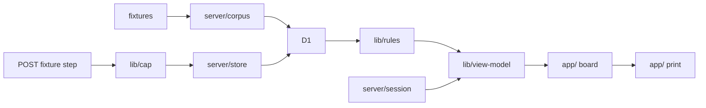

# Plan: Close CHORD's broken guarantees and port the hub node to a Cloudflare web runtime (from specs/design-review-hardening.md)

Revision 2: after the Codex plan review of 2026-11-26 (vertical slice
first, freeze after D1-backed tests, hall resilience and print as MUSTs,
security requirements made measurable, local cron is manual).

## 1. Goal and boundaries
Goal: no sensitive or corpus-derived data at HEAD of the fork, one agreed
design, and a web hub node on the Cloudflare stack whose board keeps the
rules, age and privacy guarantees and runs on a disconnected Windows
laptop.
- In scope: corpus containment plus guard; `node/` scaffold (Next.js 16 +
  vinext + wrangler + D1) with a runtime spike; contracts, rules and
  temporal store; per-session coordinator gate; staleness, print view and
  disconnected acceptance; design doc reconciliation.
- Cut: Companion AI-drafted tasks (ADR-005 wins); neighbours panel and
  roster detail on the board.
- Deferred to the next goal: Ask (Kea) with fixed refusal, door flow,
  browser offline cache, live feed adapters, automatic hall polling,
  regional map, Cloudflare deploy (release target), git history purge
  (owner decision).
- Success: the six spec acceptance items, each with its DoD receipt.

## 2. Minimal acceptable loop
Fictional corpus -> local D1 -> fixture step -> CAP -> rules -> posture ->
board under `wrangler dev` with the network off; public view shows no
restricted asset; unlock shows them for that browser only; pausing a feed
degrades its tile; the print view renders; state survives a restart.

## 3. Tech stack
Next.js 16.3 App Router, React 19.2, TypeScript 5, Tailwind v4 (from the
CHRD scaffold); vinext + Vite + wrangler for Cloudflare Workers, exact
versions pinned by T1-NODE-SCAFFOLD; D1; WebCrypto HMAC for the session;
`node --test` with type stripping for `src/lib` (no test dependency);
Python 3.13 stdlib for the repo guard. Fallback if the vinext spike fails:
OpenNext adapter, decided and recorded in T1-NODE-SCAFFOLD.

## 4. Directory structure
```
node/                      web hub node (new)
  migrations/0001_init.sql D1 schema
  fixtures/demo-corpus.json fictional hubs, assets, roles, catalogue
  fixtures/feeds/*.json    fictional CAP fixtures for replay
  src/lib/                 pure TS: contracts, cap, rules, view model (+ *.test.ts)
  src/server/              D1 store, session, corpus load
  src/app/                 pages and route handlers
  scripts/hall-check.ps1   disconnected start and restart acceptance
  wrangler.jsonc
corpus/                    gitignored real corpus output (WREMO, GWRC)
tools/check_published.py   repo guard (new) + tools/test_check_published.py
tools/corpus-inventory.txt committed list of corpus-derived paths the guard forbids
```

## 4.5 Module design

- lib/cap: fixture payload -> CapAlert with (source, identifier) key.
- server/store: idempotent upsert, Cancel/Update supersede by sent time,
  out-of-order references held until the target arrives, cursor reads.
- lib/rules: spatial match, trust, staleness, posture; pure, cursor-scoped.
- server/session: unlock, HMAC cookie, expiry, logout, attempt limit, Origin check.
- lib/view-model: removes restricted rows by ViewMode before render;
  store error -> error state, never green.

## 5. Data model and state machine
D1 tables: source, observation (source_id, cap_identifier UNIQUE,
sent_at, observed_at, fetched_at, expires_at, superseded_by,
superseded_at), pending_reference, hub, hub_asset, role, task_template,
feed_state, unlock_attempt. Observation at cursor t is active when
`observed_at <= t` and (`superseded_at` is null or `superseded_at > t`)
and (`expires_at` is null or `expires_at > t`). Feed state: running <->
paused, persisted. Posture per hub: green / watch / act / respond, or
error when the store read fails.

## 6. Contracts and core interfaces
Frozen at the end of T1-NODE-RULES-REPLAY (after the D1-backed Cancel,
rewind and re-fetch tests pass): `node/src/lib/contracts.ts`,
`node/migrations/0001_init.sql`, `node/fixtures/demo-corpus.json` shape.
Routes: `GET /`, `GET /hub/[id]?at=`, `GET /hub/[id]/print?at=`,
`POST /api/unlock`, `POST /api/lock`, `POST /api/feeds/[id]/pause|resume`
(coordinator), `POST /api/fixtures/step` (coordinator). No Ask, contacts or
seed route; no CORS headers.

## Files that change
- .gitignore
- ingest_wremo.py
- tools/build_plan_chunks.py
- tools/check_published.py (new)
- tools/test_check_published.py (new)
- tools/corpus-inventory.txt (new)
- out/ (removed)
- HubNode/HubNode/Resources/Corpus/ (removed)
- HubNode/README.md
- HubNode/FEATURES.md
- architecture.md
- verified-findings.md
- scope-and-pitch-v4.md
- Wellington Design System Draft/export/hub-companion-prd-v0.3.md
- docs/index.html
- docs/CAPABILITIES.md (new)
- LICENSE (new)
- node/** (new)

## Order of work
1. W1, in parallel: T1-CORPUS-OUT-OF-REPO (2h), T1-NODE-SCAFFOLD (2h, runtime spike), T1-DESIGN-RECONCILE (2h, docs).
2. T1-NODE-RULES-REPLAY (3h); contracts freeze at its end.
3. T1-NODE-VIEW-GATE (2h).
4. T1-NODE-HALL-PRINT (3h), then integrated acceptance with the network off.
Critical path: 2 + 3 + 2 + 3 = 10h inside the 12h arc.

## 7. Task split (dependencies and parallel windows)

| Card | Priority | Output | depends_on | Parallel window | Freeze point |
|---|---|---|---|---|---|
| T1-CORPUS-OUT-OF-REPO | MUST | inventory, corpus-derived files out of HEAD, ingest to gitignored corpus/, guard script and tests | - | W1 | - |
| T1-NODE-SCAFFOLD | MUST | node/ Next.js 16 + vinext + wrangler + D1 migration, minimal board from the fictional corpus, spike receipt for Windows build, D1, cookie and scheduled handler | - | W1 | - |
| T1-DESIGN-RECONCILE | MUST | ADR-010, ADR-005 on every surface, counts fixed, MIT engine licence, CAPABILITIES.md, HubNode legacy notice | - | W1 | - |
| T1-NODE-RULES-REPLAY | MUST | contracts, CAP normaliser, D1 store with identity, Cancel/Update at cursor, persisted pause, rules and posture with the review fixes, fixture step route | T1-NODE-SCAFFOLD | - | yes |
| T1-NODE-VIEW-GATE | MUST | per-session coordinator gate, ViewMode filtering, two-jar integration tests, no Ask/contacts/seed route | T1-NODE-RULES-REPLAY | - | - |
| T1-NODE-HALL-PRINT | MUST | board age and fetch badges, stale and error states, A4 print view, hall-check.ps1 disconnected and restart acceptance | T1-NODE-VIEW-GATE | - | - |

## Risks
- HEAD removal does not remove history or forks (flagged concern; owner decision).
- The legacy HubNode build and runtime are unsupported after corpus removal; nobody can verify on macOS.
- vinext compatibility with Next 16.3 is unverified; the spike decides vinext or OpenNext before any feature code. OpenNext is not a guaranteed drop-in.
- Local cron does not run automatically under wrangler dev; hall polling is manual fixture stepping this version.
- D1 limits: bound imports and scans, use indexes and batches.
- 10h critical path against a 12h arc; if the spike fails, scope is cut explicitly, not stretched.
- A pattern guard cannot prove copyrighted text is absent; the inventory plus guard is the control, reviewed by a human.

## Proof
- Guard: `python -m unittest tools.test_check_published` and `python tools/check_published.py` exit 0.
- Node: `npm --prefix node run typecheck`, `npm --prefix node test`, `npm --prefix node run build` exit 0.
- Security: two-cookie-jar integration tests in `node test` (not screenshots).
- Hall: `pwsh node/scripts/hall-check.ps1` exit 0 with the network adapter off, receipt pasted.
- Docs: reviewer-verified against the diff.

## 10. After merge
none this version (development-only target)
